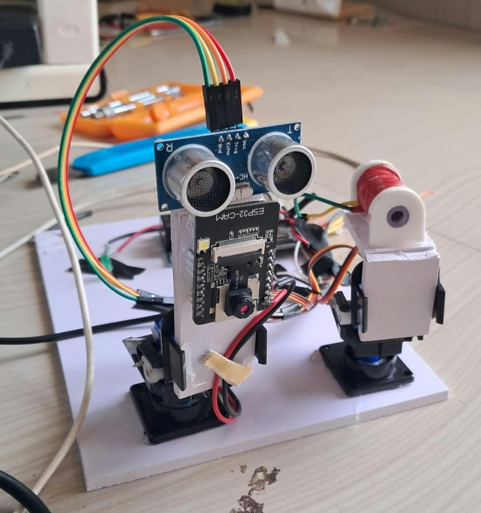
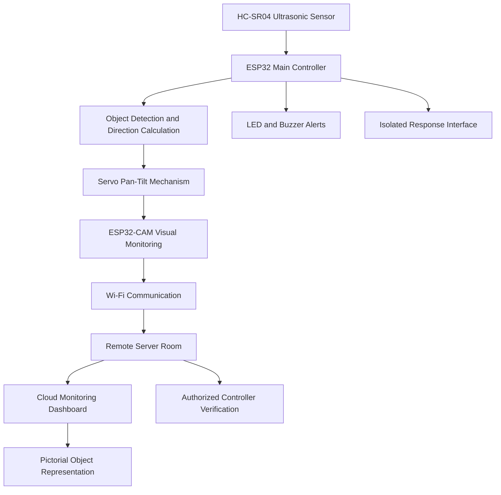
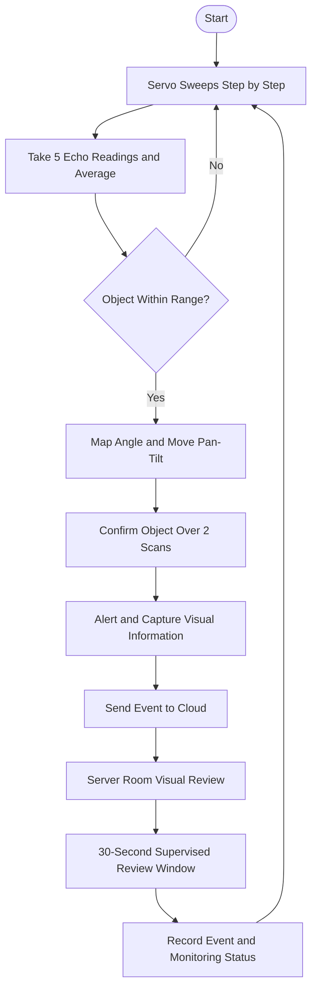

# 📡 AI-Enabled IoT Autonomous Radar Surveillance and Target Tracking System with Cloud Monitoring

  

  **Autonomous Perimeter Surveillance | Object Detection | Directional Tracking | Cloud Monitoring**

  
  
  
  

---

## 1. 📌 Project Overview

The AI-Enabled IoT Autonomous Radar Surveillance and Target Tracking System is an embedded surveillance prototype designed for monitoring border boundaries, restricted zones and sensitive areas where continuous human monitoring may be difficult.

The system uses an HC-SR04 ultrasonic sensor to scan the surrounding area, detect objects and measure their approximate distance. Servo motors determine the direction of the detected object and orient the pan-tilt camera mechanism accordingly.

The ESP32-CAM captures visual information and transmits it through Wi-Fi to a remote server-room monitoring interface. The cloud dashboard presents detected-object information through a pictorial representation, allowing an authorized controller to review the event.

A 30-second supervised review window is incorporated for controller verification. The prototype also includes LED and buzzer alerts and a relay-controlled solenoid-based response subsystem.

## 2. 🎯 Project Objectives

- Develop an ultrasonic-based object detection mechanism.
- Measure object distance and determine approximate direction.
- Implement automatic scanning using servo motors.
- Orient the camera toward detected objects.
- Integrate ESP32-CAM for visual monitoring.
- Generate alerts using LED and buzzer.
- Transmit detected-object information to a cloud monitoring interface.
- Provide a 30-second supervised review window.
- Integrate embedded hardware and IoT communication.

## 3. 🏗️ System Block Diagram

## 4. ⚙️ Software Algorithm / Workflow

The following workflow follows the seven stages presented in the Phase II project review.

### Accuracy Techniques

- Average of five ultrasonic echo readings.
- Temperature-compensated speed-of-sound calculation.
- Calibrated angle-to-servo mapping.
- Consecutive-scan confirmation to reduce false alerts.
- Servo settling delay for improved positioning.

## 5. ☁️ IoT and Cloud Monitoring

The project uses Wi-Fi communication to transmit detected-object information to a remote monitoring interface.

### Cloud Monitoring Functions

- Receives object detection information.
- Displays a pictorial representation of detected objects.
- Supports remote visual monitoring.
- Provides event information to the server-room controller.
- Supports a 30-second supervised review window.

### Monitoring Process

1. An object is detected by the ultrasonic sensor.
2. The camera is oriented toward the detected direction.
3. ESP32-CAM captures visual information.
4. The information is transmitted to the remote monitoring interface.
5. The controller reviews the detected event.
6. The event and monitoring status are recorded.

## 6. ⏱️ Supervised Monitoring System

The prototype incorporates a 30-second review window after object detection.

During this period, the authorized controller can review the visual information received in the server room and assess the detected event.

The response subsystem is documented as an isolated relay-controlled solenoid-based prototype interface. Any potentially harmful actuation must remain disabled unless independently authorized by a qualified human operator.

## 7. 🔧 Hardware Components

| Component | Purpose |
|---|---|
| ESP32 DevKit V1 | Main controller |
| HC-SR04 Ultrasonic Sensor | Object detection and distance measurement |
| ESP32-CAM | Visual monitoring |
| SG90 Servo Motors (2) | Pan and tilt camera positioning |
| Relay Module | Isolated response interface |
| Solenoid Actuator | Prototype response subsystem |
| LED | Visual indication |
| Buzzer | Audible alert |
| FTDI232 | ESP32-CAM programming |
| Power Supply | Power management |

## 8. 🔌 Circuit / Hardware Design

### ESP32 Pin Configuration

| Module | ESP32 Connection | Supply |
|---|---|---|
| HC-SR04 TRIG | GPIO 5 | 5V |
| HC-SR04 ECHO | GPIO 18 (via voltage divider) | 5V |
| Pan Servo | GPIO 13 | 5V |
| Tilt Servo | GPIO 12 | 5V |
| LED | GPIO 2 | 3.3V logic |
| Buzzer | GPIO 4 | 3.3V logic |
| ESP32-CAM | Separate Wi-Fi link; FTDI232 programming | 5V |

**Hardware Design Notes**

- Common ground for all modules.
- Servos powered through a separate 5V rail.
- Ultrasonic ECHO signal level-shifted to 3.3V.
- Response interface electrically isolated through a driver stage.
- Verify all pin numbers and supply values against the final wired prototype.

## 9. 💻 Software and Technologies

- Arduino IDE 2.3.10
- Embedded C/C++
- ESP32 Programming
- Wi-Fi Communication
- IoT and Cloud Monitoring
- Hardware Interfacing

## 10. ✨ Key Features

- Autonomous ultrasonic scanning.
- Object distance measurement.
- Approximate directional tracking.
- Servo-based pan-tilt camera positioning.
- ESP32-CAM visual monitoring.
- LED and buzzer alerts.
- Cloud-based pictorial event representation.
- 30-second supervised review window.
- Integrated embedded surveillance architecture.

## 11. 📊 Results and Analysis

### Improvements Reported in Phase II Review

| Parameter | Phase I | Phase II |
|---|---:|---:|
| Range error | 3.5 cm | 1 cm |
| Servo angle error | 8° | 2° |
| Alert delay | 1.2 s | 0.4 s |

*Values are those reported in the project presentation and should be validated against the team's original test measurements.*

### Implementation Progress

**Hardware Work**
- Prototype assembled and wired.
- Pan-tilt camera mount fitted.
- Modules powered and tested.
- Calibration completed.

**Software Work**
- Scanning, detection and tracking logic implemented.
- Filtering and angle calibration added.
- ESP32-CAM streaming and alerts integrated.
- IoT/cloud data communication established.

## 12. 🚀 Future Scope

- AI-based object recognition and classification.
- Improved cloud monitoring dashboard.
- Remote notifications.
- Enhanced object tracking.
- Larger-area surveillance coverage.
- Improved prototype optimization.

## 13. 👨‍💻 Project Team

| Team Member | USN |
|---|---|
| Deepa Paris Naganur | 2BA23EC035 |
| Kartik Veeranagoudar | 2BA23EC044 |
| Suhana Nadaf | 2BA23EC112 |
| Vikas V Menasagi | 2BA23EC121 |

**Project Guide:** Dr. Vijayalakshmi S. Jigajinni  
Associate Professor

**Department:** Electronics and Communication Engineering

**Institution:** Basaveshwar Engineering College, Bagalkot

---

  **Developed as an Engineering Major Project**
   
  ❤️ Embedded Systems | IoT | Digital Electronics | Automation

