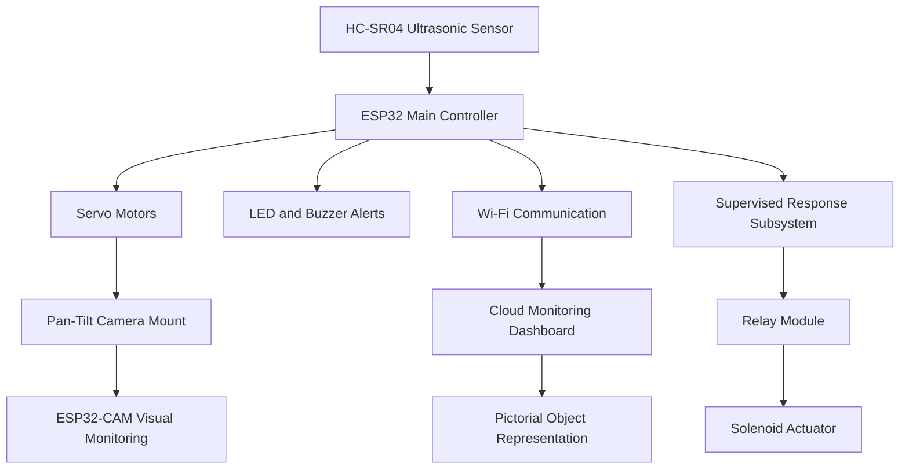
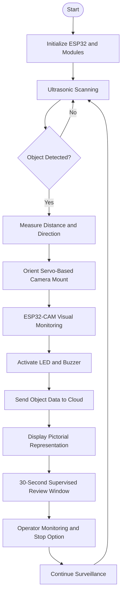

# 📡 AI-Enabled IoT Autonomous Radar Surveillance and Target Tracking System with Cloud Monitoring

  

  <b>ESP32-Based Autonomous Surveillance and Target Tracking Prototype</b>

  
  
  
  

---

## 📌 1. Project Overview

This project presents an AI-enabled IoT autonomous radar surveillance and target tracking prototype developed using ESP32.

The system integrates ultrasonic object detection, servo-based directional tracking, ESP32-CAM visual monitoring, alert generation and cloud-based monitoring.

When an object is detected, the system determines its approximate direction and positions the camera toward the detected object. The detected-object information is also displayed through a pictorial representation on the cloud monitoring interface.

A 30-second supervised response window is provided, during which an operator can stop the system, otherwise the gun will shoot automatically. The prototype also includes a relay-controlled solenoid-based response subsystem.

## 🎯 2. Project Objectives

- Develop an ultrasonic-based object detection system.
- Measure object distance and determine approximate direction.
- Implement automatic directional scanning using servo motors.
- Integrate ESP32-CAM for visual monitoring.
- Generate alerts using LED and buzzer.
- Display detected-object information on a cloud monitoring interface.
- Integrate a time-limited, operator-supervised response subsystem.

## 🏗️ 3. System Block Diagram

## ⚙️ 4. System Workflow

## ☁️ 5. IoT and Cloud Monitoring

The project incorporates Wi-Fi-based communication for cloud monitoring.

### Cloud Monitoring Features

- Receives detected-object information.
- Displays object detection information through a pictorial representation.
- Provides remote monitoring of the surveillance system.
- Supports monitoring during the supervised response window.

## ⏱️ 6. Time-Based Monitoring

The prototype incorporates a 30-second supervised monitoring window after object detection.

The operator can monitor the detected event and stop the system during this period.

The response subsystem is documented as a relay-controlled solenoid-based prototype module. Detailed actuation instructions are intentionally excluded from this public documentation.

## 🔧 7. Hardware Components

| Component | Purpose |
|---|---|
| ESP32 DevKit V1 | Main controller |
| HC-SR04 Ultrasonic Sensor | Object detection and distance measurement |
| ESP32-CAM | Visual monitoring |
| SG90 Servo Motors | Pan and tilt movement |
| Relay Module | Response subsystem interface |
| Solenoid Actuator | Response subsystem component |
| LED | Visual indication |
| Buzzer | Audible alert |
| FTDI232 | ESP32-CAM programming |
| Power Supply | Power management |

## 💻 8. Software and Technologies

- Arduino IDE 2.3.10
- Embedded C/C++
- ESP32 Programming
- Wi-Fi Communication
- IoT and Cloud Monitoring
- Hardware Interfacing

## ✨ 9. Key Features

- **Autonomous Scanning:** Continuous area scanning using ultrasonic sensing.
- **Object Detection:** Distance measurement using HC-SR04.
- **Directional Tracking:** Servo-controlled camera positioning.
- **Visual Monitoring:** ESP32-CAM integration.
- **Alert System:** LED and buzzer indication.
- **Cloud Monitoring:** Pictorial representation of detected objects.
- **Timed Monitoring:** 30-second supervised review window.
- **Response Subsystem:** Relay-controlled solenoid-based prototype module.

## 📊 10. Results and Improvements

- Improved ultrasonic distance measurement accuracy.
- Improved servo angle calibration.
- Better camera positioning toward detected objects.
- Reduced false alerts through consecutive-scan confirmation.
- Integrated surveillance, alert and response subsystems.
- Established IoT/cloud communication.

## 🚀 11. Future Scope

- AI-based object recognition and classification.
- Advanced cloud monitoring dashboard.
- Remote notifications.
- Improved object tracking.
- Extended surveillance coverage.
- Further prototype optimization.

## 👨‍💻 12. Project Team

| Team Member | USN |
|---|---|
| Deepa Paris Naganur | 2BA23EC035 |
| Kartik Veeranagoudar | 2BA23EC044 |
| Suhana Nadaf | 2BA23EC112 |
| Vikas V Menasagi | 2BA23EC121 |

**Project Guide:** Dr. Vijayalakshmi S. Jigajinni  
Associate Professor

**Department:** Electronics and Communication Engineering

**Institution:** Basaveshwar Engineering College, Bagalkot

---

  <b>Developed as an Engineering Major Project</b>
   
  ❤️ Embedded Systems | IoT | Electronics | Automation

