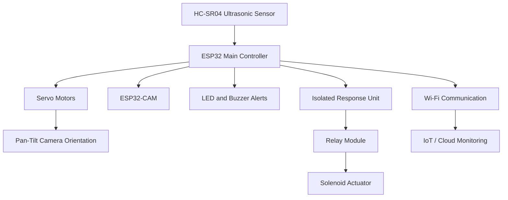
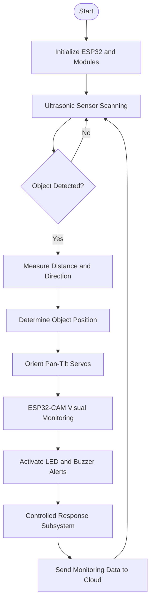

# 📡 AI-Enabled IoT Autonomous Radar Surveillance and Target Tracking System with Cloud Monitoring

  
  
  
  

## 📌 Project Overview

This project presents an ESP32-based autonomous surveillance prototype that integrates ultrasonic object detection, servo-based directional tracking, camera monitoring and IoT-based cloud connectivity.

The system detects objects using an HC-SR04 ultrasonic sensor, determines their approximate direction, and automatically positions a pan-tilt camera mechanism for visual monitoring. LED and buzzer alerts indicate detected objects, while a relay-controlled solenoid-based response unit is included as a prototype subsystem.

## 🎯 Objectives

- Develop an ultrasonic-based object detection system.
- Measure object distance and determine its direction.
- Implement automatic directional scanning using servo motors.
- Integrate ESP32-CAM for visual monitoring.
- Generate alerts using LED and buzzer.
- Integrate an isolated relay-controlled response unit.
- Enable Wi-Fi-based IoT and cloud monitoring.

## 🏗️ System Block Diagram

## ⚙️ System Workflow

## 🔧 Hardware Components

| Component | Purpose |
|---|---|
| ESP32 DevKit V1 | Main controller |
| HC-SR04 | Object detection and distance measurement |
| ESP32-CAM | Visual monitoring |
| SG90 Servo Motors | Pan and tilt movement |
| Relay Module | Response unit interface |
| Solenoid Actuator | Response unit component |
| LED | Visual indication |
| Buzzer | Audible alert |
| FTDI232 | ESP32-CAM programming |
| Power Supply | System power |

## 💻 Software & Technologies

- Arduino IDE 2.3.10
- Embedded C/C++
- ESP32 Programming
- Wi-Fi Communication
- IoT and Cloud Monitoring

## ✨ Key Features

- **Autonomous Scanning:** Continuous area scanning using ultrasonic sensing.
- **Object Detection:** Distance measurement using HC-SR04.
- **Directional Tracking:** Servo-based camera positioning.
- **Visual Monitoring:** ESP32-CAM integration.
- **Alert System:** LED and buzzer indication.
- **Response Subsystem:** Relay-controlled solenoid-based prototype module.
- **Cloud Connectivity:** Wi-Fi-based monitoring and data communication.

## 📊 Results & Improvements

- Improved ultrasonic distance measurement accuracy.
- Better servo angle calibration.
- Improved camera positioning toward detected objects.
- Reduced false alerts through consecutive-scan confirmation.
- Integrated surveillance, alert and response subsystems.
- Established IoT/cloud communication.

## 🚀 Future Scope

- AI-based object recognition and classification.
- Advanced cloud monitoring dashboard.
- Remote notifications.
- Improved tracking performance.
- Extended surveillance coverage.

## 👨‍💻 Project Team

- Deepa Paris Naganur
- Kartik Veeranagoudar
- Suhana Nadaf
- Vikas V Menasagi

**Project Guide:** Dr. Vijayalakshmi S. Jigajinni  
Associate Professor, Department of Electronics & Communication Engineering

**Institution:** Basaveshwar Engineering College, Bagalkot

## 📷 Project Demonstration

Add your actual prototype photographs and demonstration video here.

---

  <b>Built with ❤️ using Embedded Systems, IoT and Electronics</b>

